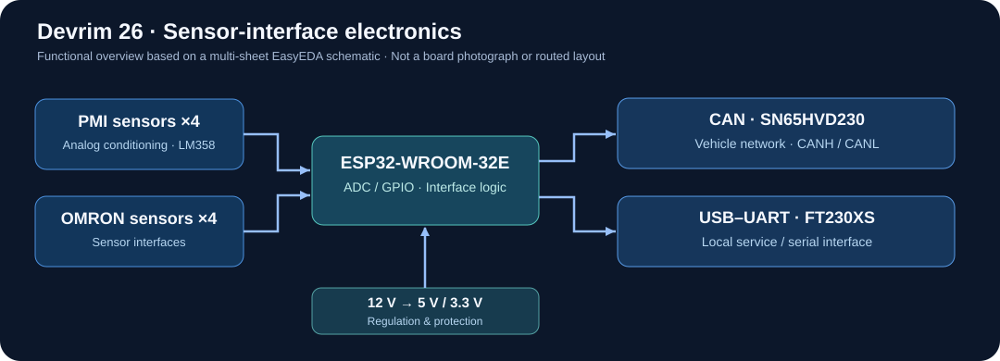

# Ece Ceyla Demir

**Electrical and Electronics Engineering | Middle East Technical University (METU)**

I'm a senior undergraduate student working toward a career in analog and mixed-signal IC design, RFICs, and semiconductor research. I enjoy projects that start with device or circuit analysis and lead to a working system or a physical design.

My recent work includes RF characterization and electromagnetic simulation at **Karlsruhe Institute of Technology (KIT)**, underwater acoustic telemetry at **Universitat Politècnica de Catalunya (UPC)**, and embedded hardware for **METU Formula Racing**.

## Projects

### [SiGe HBT and RFIC Characterization — KIT](https://github.com/ececeyla/ihp-sg13g2-rfic-characterization)
**IHP SG13G2 · Ngspice · Xschem · KLayout · openEMS**

At KIT, I studied the `npn13G2` SiGe HBT through DC, AC, S-parameter, noise, and stability analyses. I also worked on EM simulations of on-chip transmission-line structures and a three-port T-junction, along with DRC/LVS checks for an HBT test layout.

The repository contains my internship report, simulation figures, technical notes, and supplementary analysis scripts.

### [Underwater Acoustic Telemetry — UPC / SARTI](https://github.com/ececeyla/underwater-acoustic-telemetry)
**ESP32-S3 · SIM7080G · GNSS · Acoustic modems · C++ · Python**

I worked on the firmware and telemetry workflow for a network of surface and submerged acoustic nodes. The system combines acoustic ranging, GNSS coordinates, cellular connectivity, and browser-based monitoring.

The repository includes the node firmware, two viewer implementations, and a small offline test setup for the positioning calculations.

### [Devrim 26 Sensor PCB — METU Formula Racing](https://github.com/ececeyla/metu_formula)
**ESP32 · CAN bus · Sensor conditioning · Power regulation · EasyEDA**

As part of the METU Formula Racing electronics team, I contributed to the sensor-interface PCB used on **Devrim 26**. The design includes an ESP32 controller, a CAN transceiver, a USB-to-UART interface, analog sensor inputs, and regulated power supplies. The board was manufactured, tested, and installed on the car.

## Current work

For my senior design project, I'm working on the receiver-IC architecture of a laser range detector, with a focus on the analog front end and time-programmed gain. This has strengthened my interest in designing and verifying integrated circuits, particularly high-speed analog and RF receiver blocks.

## Technical interests

Analog and mixed-signal ICs · RF/mmWave circuits · SiGe devices · Transistor-level simulation · EM modeling · Circuit and layout verification

## Tools

`Ngspice` · `Xschem` · `IHP SG13G2 OpenPDK` · `KLayout` · `openEMS` · `Python` · `C/C++` · `ESP32` · `PlatformIO` · `EasyEDA`

---

*The research and Formula Racing projects involved wider teams. Simulation results and supplementary examples are identified in their respective repositories.*
